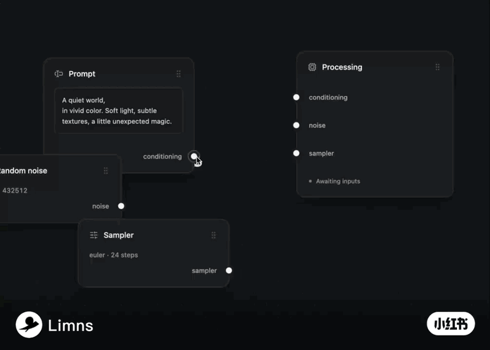

<div align="center">

# ⚡ SparkFlow

<p align="center">
  <b>A modern, high-performance node flow canvas with physics-based electric arc snapping and laser border beam animations.</b>
</p>

[](https://life2you.github.io/spark-flow/)
[](https://github.com/life2you/spark-flow)

<br />

<p align="center">
  
</p>

[](https://www.typescriptlang.org/)
[](https://react.dev/)
[](https://reactflow.dev/)
[](https://tailwindcss.com/)
[](LICENSE)

</div>

---

## 🌟 Highlights (核心亮点)

- ⚡ **Physics-based Electric Spark Snapping (物理级高频电火花磁吸)**:
  基于法向量抖动与正弦包络算法，在拉线逼近端口时激发出逼真的高压空气击穿电弧、次级分叉（Forked Sub-arcs）与飞溅火花粒子（Embers）。
- 🌈 **Adaptive Smooth Bézier Splines (自适应平滑发光连线)**:
  随节点位置实时自适应调整切线张力，具备双层发光霓虹材质。悬停中点可快速一键调色与剪断。
- 🎨 **Golden-Ratio Neon Color Auto-Generation (黄金分割自动配色)**:
  未指定通道色彩时，算法基于黄金分割率（`0.6180339887`）在色轮上为任意自定义端口类型生成高饱和度霓虹发光色，彻底告别单调白线。
- ✨ **Laser Border Beam & Port Aura (圆角激光边框与侧边通电光晕)**:
  节点通电接通时，卡片圆角边缘触发激光流光跑道，并在对应端口边缘呈现垂直通电晕染光柱。
- 🔊 **Zero-dependency Web Audio Synthesizer (原生零依赖合成拟真音效)**:
  纯底层 Web Audio 振荡器与白噪波带通滤波实时合成电弧抽搐声（Zap）、机械闭合声（Click）与消磁拔出声。
- 🔌 **Dual Ecosystem Support (双模生态架构)**:
  - **Standalone Canvas**: 零外部重图库依赖，内置无限滚轮焦点缩放、平移画布与动态节点增删。
  - **React Flow Plugin (`@xyflow/react`)**: 3 行代码无缝升级现有 React Flow 项目的 Edge 与 Handle。

---

## 🚀 Quick Start (快速开始)

### 选项 A：在现有 React Flow (`@xyflow/react`) 项目中使用 (推荐)

如果你已经在用 React Flow 开发 AI Agent 或自动化工作流，直接替换 Edge 与 Handle 即可：

```tsx
import { ReactFlow, Position } from '@xyflow/react';
import '@xyflow/react/dist/style.css';
import { ElectricEdge, SparkFlowHandle, BorderBeamCard } from 'spark-flow/react-flow';

// 1. 注册高能发光电弧边缘
const edgeTypes = {
  electric: ElectricEdge,
};

// 2. 自定义节点中包裹激光卡片与增强 Handle
function PromptNode() {
  return (
    <BorderBeamCard title="Prompt" active={true} beamColor="#f59e0b">
      <div className="p-2 text-xs text-neutral-300">A quiet world, in vivid color...</div>
      <SparkFlowHandle
        type="source"
        position={Position.Right}
        id="out-conditioning"
        color="#f59e0b"
        glow="rgba(245, 158, 11, 0.65)"
      />
    </BorderBeamCard>
  );
}

// 3. 正常挂载 ReactFlow
export default function FlowEditor() {
  return (
    <ReactFlow
      edgeTypes={edgeTypes}
      nodes={nodes}
      edges={edges}
    />
  );
}
```

---

### 选项 B：独立轻量画布模式 (零外部重依赖)

适合构建产品官网微交互、AI 管道展示或轻量演示 Demo：

```tsx
import { SparkNode, BezierWire, BorderBeam, soundFX } from 'spark-flow';

function StandaloneFlow() {
  return (
    <div className="relative w-full h-screen bg-[#0c0d10]">
      <SparkNode id="prompt" title="Prompt" position={{ x: 100, y: 120 }}>
        <div>Node content...</div>
      </SparkNode>
    </div>
  );
}
```

---

## 🎛️ API Reference (核心组件参数)

### `<ElectricEdge />` (React Flow 适配边缘)
| Prop | 类型 | 默认值 | 描述 |
| :--- | :--- | :--- | :--- |
| `data.color` | `string` | `#f59e0b` | 连线核心高亮主干颜色 (Hex / HSL) |
| `data.glow` | `string` | `rgba(...)` | 外发光高斯模糊霓虹色彩 |

### `<SparkFlowHandle />` (React Flow 增强端口手柄)
| Prop | 类型 | 默认值 | 描述 |
| :--- | :--- | :--- | :--- |
| `color` | `string` | `#ffffff` | 端口处于接通或就绪状态时的发光色彩 |
| `glow` | `string` | `transparent`| 外层光晕阴影色彩 |
| `isSnapping` | `boolean` | `false` | 是否激活端口外侧的磁吸闭合光环 |
| `showRipple` | `boolean` | `false` | 是否触发锁定瞬间的同心圆冲击波波纹 |

### `<BorderBeamCard />` (发光激光卡片容器)
| Prop | 类型 | 默认值 | 描述 |
| :--- | :--- | :--- | :--- |
| `active` | `boolean` | `false` | 是否点亮圆角激光流光与侧边通电光晕柱 |
| `beamColor` | `string` | `#f59e0b` | 流光光束的渐变专色 |
| `activePort` | `string` | `null` | 当前通电的端口通道名称 (如 `conditioning`) |

---

## 💻 Local Development (本地体验与试玩)

```bash
# 1. 克隆仓库
git clone https://github.com/life2you/spark-flow.git
cd spark-flow

# 2. 安装依赖并启动
npm install
npm run dev
```

在浏览器中打开 `http://localhost:5173`，可在顶部无缝切换体验 **“原生轻量引擎”** 与 **“React Flow 插件模式”**。

---

## 🌐 Live Playground

👉 **在线秒开试玩**: [https://life2you.github.io/spark-flow/](https://life2you.github.io/spark-flow/)

---

## 📄 License

[MIT License](LICENSE) © 2025 life2you
